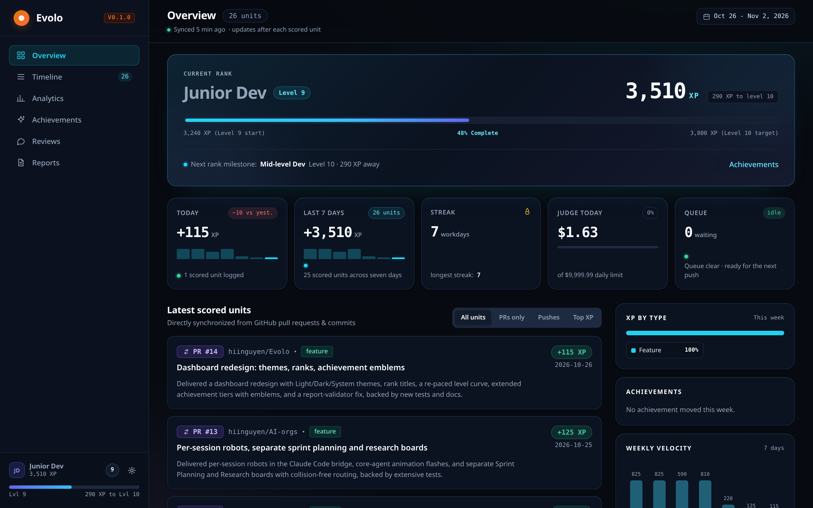
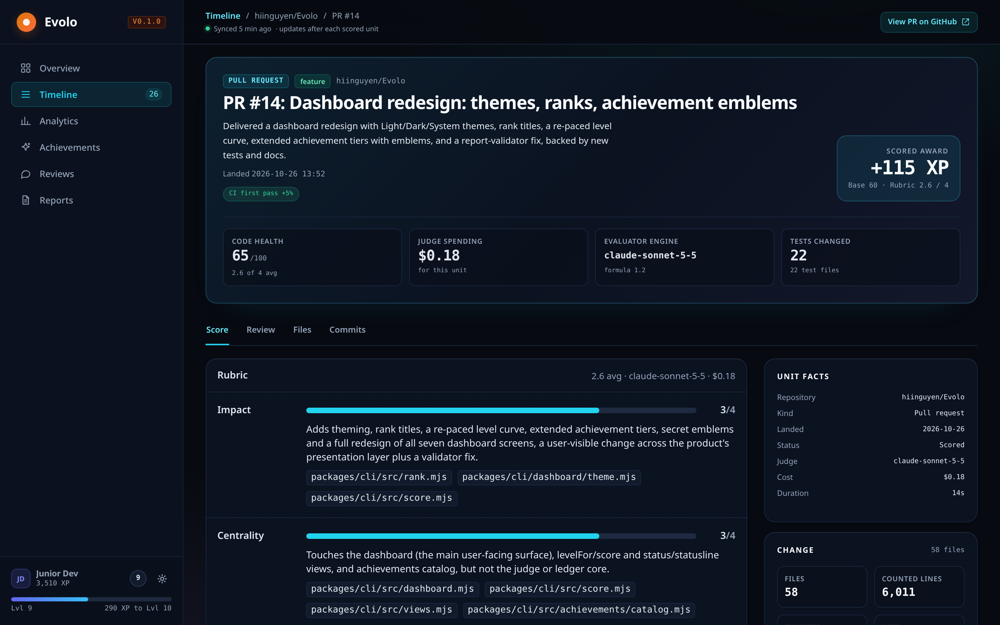
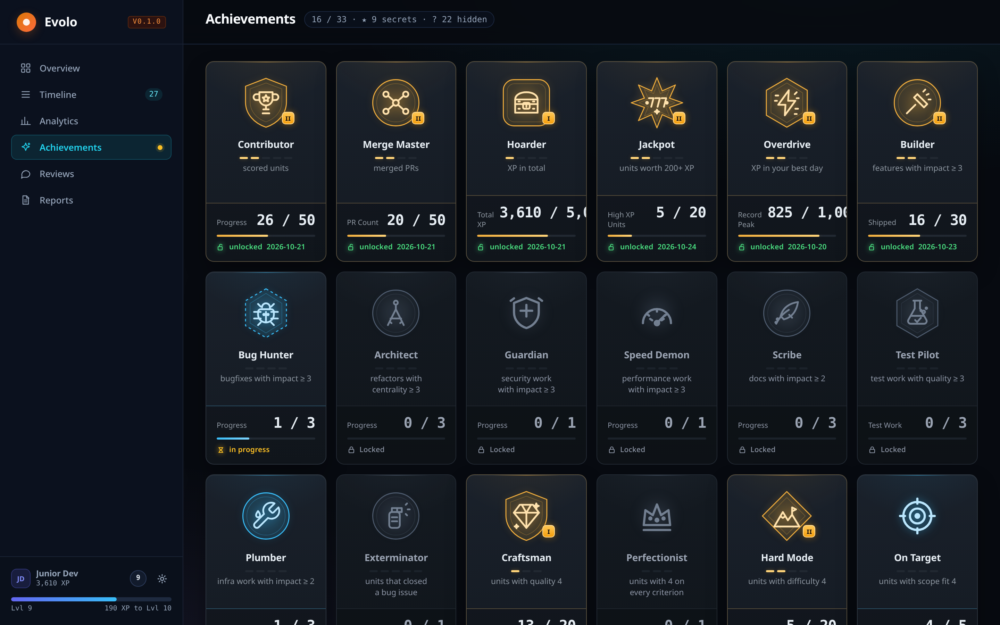

# Evolo


[](https://www.npmjs.com/package/evolo)

Evolo is a personal tool that scores your code contributions on GitHub with an AI judge and a deterministic XP formula.
It runs entirely on your machine: no server, no account.

Every push to your default branch and every PR of yours that gets merged is one contribution.
An AI judge grades that contribution against a rubric, while every number - XP, level, achievements, stats - is computed by code.
The principle throughout: **the AI only judges, the code does the math.**
Every number can be recomputed from stored data without calling the AI again.



## Features


| Feature            | Question it answers                                      | Command                                             |
| ------------------ | -------------------------------------------------------- | --------------------------------------------------- |
| XP                 | How much was this contribution worth?                    | scored automatically after every push and merged PR |
| Level and rank     | How much have I built up?                                | `evolo status`                                      |
| Achievements       | Which milestones have I hit?                             | `evolo achievements`                                |
| Analytics          | How is the way I work changing?                          | `evolo stats`                                       |
| Code review        | What is wrong with this push or PR, what should improve? | `evolo review`                                      |
| Performance review | What did I get done this week, month or quarter?         | `evolo report`                                      |
| Dashboard          | See it all in one place?                                 | `evolo dashboard`                                   |


## Languages

Evolo supports English and Vietnamese.

- The interface - CLI output, notifications, the dashboard - is in English.
- The judge's written feedback is configurable: code reviews (`evolo review`) and performance reviews (`evolo report`) are written in English by default, and in Vietnamese with `evolo config set review.language vi` and `report.language vi` (any other language name or code works too, e.g. `pt-BR`).
- The design documents in [`docs/`](docs/architecture.md) are written in Vietnamese.

## Requirements

- Node.js 20 or newer.
- `git`.
- GitHub CLI `gh`, signed in with `gh auth login` (to read PRs, CI and issues).
- Claude Code CLI `claude`, signed in, as the judge; opencode works as an alternative with `--judge opencode`.
- No npm dependencies and no build step: just the Node.js standard library plus `git`, `gh` and a judge.
- Linux, macOS or Windows.

## Installation

```bash
npm install -g evolo
```

That is the whole install: the package is plain Node.js modules, with no dependencies and no build step. `npx evolo` runs it without a global install.

### Platforms

Everything works on all three; only the desktop tools differ, and Evolo picks the platform's own:

| | notifications | `evolo dashboard` opens with | judge |
|---|---|---|---|
| Linux | `notify-send` | `xdg-open` | `claude` / `opencode` |
| macOS | `osascript` | `open` | `claude` / `opencode` |
| Windows | PowerShell balloon | `explorer.exe` | the judge's native `.exe` |

On Windows the judge must be a real executable: the `.cmd` shim that npm installs cannot carry Evolo's multi-line prompt, so install Claude Code with its PowerShell installer rather than through npm. Git for Windows runs the `pre-push` hook with its bundled `sh`, which is what the hook is written for.

A machine without a notification tool still scores; the results are in `evolo status` and in the log either way.

### From a clone instead

```bash
cd packages/cli && npm link
```

That is the same package, linked from the checkout instead of installed from the registry; `npm uninstall -g evolo` removes it.

### Verify and uninstall

```bash
evolo status                        # any output means the CLI runs; with no repos yet it says "no scores yet"
cd packages/cli && npm test         # the test suite, from a clone
```

To uninstall: `npm uninstall -g evolo`, then run `evolo uninstall` in each registered clone (see below).

## Usage

### 1. Register the repo you want scored

```bash
cd ~/code/my-project          # a clone of one of your GitHub repos
evolo init                    # takes the email from `git config user.email`
# or pass emails explicitly, as many as you like:
evolo init --author you@work.com --author you@gmail.com
```

`evolo init` registers the repo in `~/.evolo/repos.json` and installs a `pre-push` hook (it chains after an existing hook instead of replacing it).
Only commits by the registered emails are scored.

### 2. Just work as usual

From then on Evolo runs in the background:

- after you push to the default branch, a background worker scores that push and sends a desktop notification (with `level N!` when you level up);
- when one of your PRs is merged into the default branch, the worker finds it through `gh` and scores it as its own contribution.

Check in any time:


```bash
evolo status        # level, XP, the queue, today's judge spending, the latest scores
evolo why           # how the latest unit was scored: rubric, evidence, formula
evolo why #14       # by PR number, by commit, or by unit id
evolo review        # ask a separate judge to review that unit's code
evolo report week   # a performance review of the week: written by AI, every citation checked by code
evolo dashboard     # writes ~/.evolo/dashboard.html and opens it in the browser
```

When a scoring attempt fails (no network, the judge unavailable), the job stays in the queue and retries after 1, 5 and 30 minutes; `evolo retry` forces a retry now.

### 3. Integrate with Claude Code (optional)

```bash
evolo claude install    # the /evolo skill, a SessionStart hook that syncs, a status line with level and XP
```

## Commands


| Command                                                                                                  | Meaning                                                                                          |
| -------------------------------------------------------------------------------------------------------- | ------------------------------------------------------------------------------------------------ |
| `evolo init [--repo <dir>] [--author EMAIL]... [--remote NAME]`                                          | Register a repo and install the `pre-push` hook                                                  |
| `evolo uninstall [--repo <dir>]`                                                                         | Remove the hook and the registration; scores are kept                                            |
| `evolo sync [--background]`                                                                              | Queue newly merged PRs, re-check the ledger, start the worker                                    |
| `evolo status`                                                                                           | Level, rank, XP, the queue, today's judge spending, the latest scores                            |
| `evolo stats [week|month|quarter] [--previous]`                                                          | Analytics of this calendar period against the previous one, plus the workday streak              |
| `evolo achievements`                                                                                     | Every achievement: tier, progress, and the hidden group                                          |
| `evolo dashboard [--no-open]`                                                                            | Write the dashboard page and open the browser (with `--no-open` just print its path)             |
| `evolo why [<commit>|#<pr>|<unit id>] [--repo <dir>]`                                                    | Explain a unit's rubric scores, evidence and XP formula                                          |
| `evolo review [<commit>|#<pr>|<unit id>] [--repo <dir>] [--again] [--judge claude|opencode] [--model M]` | A code review of one unit by a separate judge, saved under `~/.evolo/reviews/`                   |
| `evolo report [week|month|quarter] [--previous] [--again] [--judge claude|opencode] [--model M]`         | A performance review of a period, saved under `~/.evolo/reports/`                                |
| `evolo retry`                                                                                            | Score the failed units again, and retry waiting jobs now                                         |
| `evolo statusline`                                                                                       | One line for Claude Code's status line                                                           |
| `evolo claude install|uninstall`                                                                         | Install or remove the `/evolo` skill, the `SessionStart` hook and the status line in Claude Code |
| `evolo config [get <key> | set <key> <value>]`                                                           | Read and change the settings in `~/.evolo/config.json`                                           |
| `evolo worker`                                                                                           | Run the worker until the queue is empty (the hook and sync start it on their own)                |
| `evolo evaluate --repo <dir> --out <dir> [options...]`                                                   | Score by hand - `--range`, `--pr` or SHAs - into a directory of its own, outside the ledger      |


## Configuration


| Key                | Default  | Meaning                                                           |
| ------------------ | -------- | ----------------------------------------------------------------- |
| `budget.daily-usd` | `5`      | Daily cap on judge spending; past it, units wait for the next day |
| `review.language`  | `en`     | The language code reviews are written in, e.g. `vi`               |
| `report.language`  | `en`     | The language performance reviews are written in, e.g. `vi`        |
| `dashboard.theme`  | `system` | The dashboard's colour theme: `light`, `dark` or `system`         |
| `dashboard.name`   | (empty)  | The name the dashboard shows next to your rank                    |


```bash
evolo config set review.language vi
evolo config set budget.daily-usd 2.50
```

## How XP works

**The unit of scoring** is one push to the default branch or one merged PR, not a single commit.
Commits are drafts - they get squashed, amended or dropped; the score should reflect the work, not your commit habits.

**The rubric** has five criteria, each graded 0-4 with evidence quoted from the code: `impact`, `centrality`, `difficulty`, `quality`, `scope_fit`.
The judge runs in a read-only sandbox restricted to an allowlist of git commands, so it cannot write anything to your repo.
Its output goes through a validator before use: missing evidence or over-the-cap scores are rejected.

**The XP formula** takes the rubric scores and the diff facts (files, lines, tests) and computes deterministically (version 1.2: XP is a multiple of 5, at least 5), see `packages/cli/src/score.mjs`.
Three signals add on top: green CI right away +5%, a clean merge after review +5%, closing a `bug`/`security` issue +10%.

**Levels** come from total XP: level `L` needs `20 × L × (L + 9)` XP.


| Level | Total XP | Rank                           |
| ----- | -------- | ------------------------------ |
| 1     | 200      | Intern (0-4)                   |
| 5     | 1,400    | Junior Dev (5-9)               |
| 10    | 3,800    | Mid-level Dev (10-14)          |
| 15    | 7,200    | Senior Dev (15-19)             |
| 20    | 11,600   | Staff Engineer (20-24)         |
| 30    | 23,400   | Architect (30-34)              |
| 40    | 39,200   | Distinguished Engineer (35-39) |
| 50    | 59,000   | Legend (50+)                   |


## Cost

Each scoring costs about $0.03-0.31 depending on the size of the contribution (measured with Claude Sonnet), billed to your own Claude plan.
The daily cap is set with `budget.daily-usd` (default$5); once it is spent, units wait for the next day.
Scoring by push and PR means far fewer judge calls than scoring every commit.

## Where the data lives

Everything is in `~/.evolo/`, written atomically, and never leaves your machine:


| Path                                   | Contents                                                     |
| -------------------------------------- | ------------------------------------------------------------ |
| `repos.json`                           | Registered repos, remotes, author emails                     |
| `ledger/<owner>/<name>/<unit id>.json` | Each contribution's result: rubric scores, facts, XP, status |
| `reviews/`, `reports/`                 | Saved code reviews and performance reviews                   |
| `dashboard.html`                       | The dashboard page generated from the ledger                 |
| `queue/`, `worker.lock`, `evolo.log`   | The worker's queue, lock and log                             |


Each ledger record keeps the rubric scores and the facts, enough to recompute XP under a new formula without calling the AI.

## Dashboard

`evolo dashboard` writes one static HTML page from the ledger and opens it in the browser.
Seven screens: Overview, Timeline, one contribution's detail, Analytics, Achievements, Reviews and Reports.
The page works offline, its CSP allows no network calls, and the data never leaves your machine.



The Achievements screen tracks 33 achievements in multiple tiers, plus a hidden group whose names and conditions stay secret until unlocked.



## Known limitations

- A tool for one person: deliberately no anti-cheat, no server, no leaderboard.
- The diff sent to the judge is cut at 80 KB.
- The first push after `evolo init` scores the whole history since the registration mark.
- Changing your Node version requires running `evolo init` again in each repo (the hook stores absolute paths).
- `core.hooksPath` shared with another tool can conflict.

